<div align="center">

  

  <p><strong>Cùng nhau đi xa hơn — biến mục tiêu chung thành hành động, quyết định và tri thức có thể kế thừa.</strong></p>

  <p>

    <a href="https://the-fellowship-zeta.vercel.app/">🌐 Website</a>

    ·

    <a href="https://github.com/PhamDucDuy-2280605704/the-fellowship">Mã nguồn</a>

    ·

    <a href="./docs/00-PRODUCT-BRIEF.md">Product brief</a>

    ·

    <a href="./docs/03-ARCHITECTURE.md">Kiến trúc</a>

    ·

    <a href="./docs/04-ACCESS-CONTROL.md">Phân quyền</a>

  </p>

  <p>

    

    

    

    

    

    

  </p>

  <p>

    <a href="https://github.com/PhamDucDuy-2280605704/the-fellowship/actions/workflows/verify.yml">

      

    </a>

    

    

  </p>

</div>

---

## 🏰 Giới thiệu

**The Fellowship** là không gian làm việc chung dành cho một nhóm người cùng theo đuổi mục tiêu. Dự án kết nối ba hoạt động quan trọng: tổ chức công việc, đưa ra quyết định minh bạch và lưu giữ tri thức để cả nhóm có thể tiếp tục sử dụng.

Thay vì để mục tiêu, nhiệm vụ, thảo luận và ghi chú nằm rời rạc, The Fellowship đưa chúng về cùng một workspace — nơi mọi người biết nhóm đang hướng tới điều gì, ai đang phụ trách việc gì và vì sao một quyết định được đưa ra.

> Cùng xác định mục tiêu. Cùng thực hiện công việc. Cùng lưu giữ những điều có giá trị.

## ✨ Các module chính

### ⚔️ The Fellowship — Công việc và mục tiêu

- Tạo workspace, quản lý thành viên và thiết lập vai trò riêng cho từng workspace.

- Tạo **Goals** để xác định mục tiêu, mô tả và ngày cần hoàn thành.

- Tạo **Quests**, liên kết với Goal, thiết lập mức ưu tiên, hạn hoàn thành và người phụ trách.

- Theo dõi trạng thái nhiệm vụ, ghi nhận check-in và cập nhật tiến độ.

- Thiết lập quan hệ phụ thuộc giữa các Quest; hệ thống kiểm tra quan hệ cùng workspace và ngăn chu trình phụ thuộc.

### ⚖️ The Council — Thảo luận và quyết định

- Tạo đề xuất kèm bối cảnh và nhiều phương án lựa chọn.

- Thiết lập tiêu chí đánh giá có trọng số và thời điểm kết thúc biểu quyết.

- Thành viên tham gia bỏ phiếu kín theo nguyên tắc một thành viên — một phiếu trong thời gian biểu quyết.

- Chấm điểm từng phương án theo tiêu chí; hệ thống tổng hợp điểm có trọng số trên thang **0–100**.

- Owner/Admin có thể mở biểu quyết, ghi nhận phương án được chọn cùng lý do và lưu quyết định.

- Có thể tạo Quest tiếp theo ngay từ một quyết định để chuyển kết quả thảo luận thành hành động.

### 📚 The Archives — Kho tri thức chung

- Tạo và chỉnh sửa ghi chú bằng **Markdown**.

- Gắn thẻ, lọc theo thẻ và tìm kiếm toàn văn trên tiêu đề, nội dung và thẻ.

- Liên kết ghi chú với Goal, Quest hoặc đề xuất trong Council.

- Lưu trữ và khôi phục ghi chú mà không làm mất nội dung.

- Nội dung được giới hạn trong workspace tương ứng.

### 🤝 Workspace và cộng tác

- Đăng ký, đăng nhập bằng email/mật khẩu và quản lý phiên đăng nhập.

- Tạo workspace; người tạo được gán vai trò Owner tự động.

- Mời thành viên bằng liên kết có token ngẫu nhiên được lưu dưới dạng SHA-256 hash; lời mời hết hạn sau 7 ngày và có thể thu hồi.

- Quản lý danh sách thành viên, thay đổi vai trò, gỡ thành viên và tự rời workspace.

- Thiết lập tên và mô tả workspace.

### 🕰️ Activity và quản trị nền tảng

- Timeline ghi nhận hoạt động tạo/cập nhật Goal, Quest, ghi chú và đề xuất Council; hiển thị tối đa 100 sự kiện gần nhất.

- Platform Admin có khu vực quản trị riêng để xem danh sách tài khoản, trạng thái xác nhận email/lần đăng nhập gần nhất, tạm khóa hoặc kích hoạt lại tài khoản.

- Platform Admin có thể xem danh sách workspace và thực hiện lưu trữ/khôi phục workspace.

- Các thao tác quản trị nhạy cảm được kiểm tra ở PostgreSQL/RPC phía máy chủ, không dựa vào việc ẩn giao diện.

## 🗺️ Ba trụ cột của The Fellowship

Ba module kết nối thành một vòng lặp cộng tác — từ thống nhất điều cần làm, lựa chọn cách thực hiện đến lưu lại kinh nghiệm cho lần tiếp theo.

~~~mermaid
flowchart LR
    A["⚔️ The Fellowship<br/>Goals & Quests"] --> B["⚖️ The Council<br/>Discuss & Decide"]
    B --> C["📚 The Archives<br/>Knowledge & Memory"]
    C --> A
~~~

## 🧭 Các khu vực trong ứng dụng

| Đường dẫn công khai | Chức năng |
| --- | --- |
| **/** | Trang giới thiệu The Fellowship |
| **/signup** | Tạo tài khoản |
| **/login** | Đăng nhập thành viên |
| **/forgot-password** | Bắt đầu quy trình khôi phục mật khẩu |
| **/recovery-pin** | Thiết lập PIN khôi phục tài khoản |
| **/workspaces** | Danh sách và tạo workspace |
| **/workspaces/[slug]** | Tổng quan workspace |
| **/workspaces/[slug]/goals** | Quản lý mục tiêu |
| **/workspaces/[slug]/quests** | Quản lý nhiệm vụ, người phụ trách và tiến độ |
| **/workspaces/[slug]/council** | Đề xuất, biểu quyết, chấm điểm và quyết định |
| **/workspaces/[slug]/archives** | Ghi chú, Markdown, thẻ và tìm kiếm |
| **/workspaces/[slug]/activity** | Dòng thời gian hoạt động |
| **/workspaces/[slug]/members** | Thành viên và lời mời |
| **/workspaces/[slug]/settings** | Cài đặt workspace |
| **/the-stewards-hall** | Bảng điều khiển dành cho Platform Admin |
| **/the-stewards-hall/login** | Cổng đăng nhập riêng cho Platform Admin |
| **/the-stewards-hall/accounts** | Quản lý tài khoản toàn nền tảng |
| **/the-stewards-hall/workspaces** | Quản lý workspace toàn nền tảng |

Các khu vực workspace yêu cầu tài khoản đang hoạt động và membership hợp lệ. Những trang quản trị chỉ dành cho tài khoản có quyền Platform Admin.

**Lưu ý về route quản trị:** `/the-stewards-hall` và các đường dẫn con là URL công khai cần dùng. `src/proxy.ts` rewrite chúng sang các route nội bộ `/admin` và `/steward-login`. Truy cập trực tiếp `/admin` bị trả về `404`; `/steward-login` là đích rewrite nội bộ, không phải URL quản trị cần chia sẻ.

## 🔐 Vai trò và bảo mật

The Fellowship tách biệt quyền quản trị toàn nền tảng và quyền thành viên trong từng workspace.

| Vai trò | Phạm vi |
| --- | --- |
| **Platform Admin** | Quản trị nền tảng; được cấp quyền riêng, không phải một workspace role |
| **Owner** | Chủ sở hữu workspace, quản lý thành viên và thiết lập workspace |
| **Admin** | Quản lý thành viên và các hoạt động quản trị workspace được cho phép |
| **Member** | Tạo/cập nhật nội dung và tham gia hoạt động cộng tác |
| **Viewer** | Chỉ xem dữ liệu trong workspace |

Các nguyên tắc bảo vệ dữ liệu:

- PostgreSQL **Row Level Security (RLS)** bảo vệ dữ liệu theo workspace và membership.

- Người dùng thông thường chỉ truy cập workspace mà họ có membership đang hoạt động.

- Kiểm tra vai trò và các thao tác đặc quyền được thực hiện ở phía máy chủ/cơ sở dữ liệu.

- Token lời mời được lưu dưới dạng hash, không lưu token gốc.

- Trình duyệt chỉ sử dụng Supabase Publishable Key. Không đưa Service Role Key hoặc secret vào biến môi trường có tiền tố `NEXT_PUBLIC_`.

- Ứng dụng không có chế độ workspace khách hoặc ẩn danh.

## 🧰 Công nghệ

| Lớp | Công nghệ |
| --- | --- |
| Framework | Next.js 16.4.5 — App Router |
| UI | React 19.3.0 |
| Ngôn ngữ | TypeScript 5 |
| Styling | Tailwind CSS 4 và CSS Modules |
| Authentication | Supabase Auth |
| Database | Supabase Postgres, Row Level Security và RPC |
| Next.js session | `@supabase/ssr` |
| Backend utilities | Supabase JavaScript Client |
| Hosting | Vercel |
| CI | GitHub Actions |

## 💻 Chạy dự án trên máy cá nhân

### 1. Yêu cầu

- **Node.js 22**.

- npm.

- Một dự án Supabase có quyền cấu hình Auth, Postgres và các migration.

### 2. Clone và cài đặt

```bash
git clone https://github.com/PhamDucDuy-2280605704/the-fellowship.git
cd the-fellowship
npm ci
```

### 3. Cấu hình môi trường

Sao chép file mẫu:

```bash
cp .env.example .env.local
```

Trên Windows PowerShell:

```powershell
Copy-Item .env.example .env.local
```

Điền các giá trị Supabase trong **.env.local**:

```env
NEXT_PUBLIC_SUPABASE_URL=https://<project-ref>.supabase.co
NEXT_PUBLIC_SUPABASE_PUBLISHABLE_KEY=<publishable-key>
NEXT_PUBLIC_SITE_URL=http://localhost:3000
```

Trong Supabase Dashboard, thêm `http://localhost:3000/auth/callback` vào **Authentication → URL Configuration → Redirect URLs**. Khi triển khai, cấu hình thêm URL website production và callback tương ứng.

**Lưu ý:** Không commit `.env.local`, Service Role Key, database password hoặc bất kỳ secret nào lên GitHub.

### 4. Khởi chạy môi trường phát triển

```bash
npm run dev
```

Mở http://localhost:3000.

## ✅ Kiểm tra chất lượng

| Lệnh | Mục đích |
| --- | --- |
| `npm run lint` | Kiểm tra quy tắc ESLint |
| `npm run typecheck` | Kiểm tra kiểu TypeScript |
| `npm test` | Chạy unit test |
| `npm run build` | Tạo bản build production |
| `npm run test:smoke` | Kiểm tra các route bằng production build |

GitHub Actions trong **.github/workflows/verify.yml** chạy khi push lên **main**, tạo Pull Request hoặc chạy thủ công. Pipeline cài dependencies, audit dependencies production, lint, typecheck, unit test, build production và smoke test.

Các kiểm tra tự động không thay thế việc xác minh đăng nhập thực tế, RLS, cách ly dữ liệu giữa workspace và ma trận quyền của từng vai trò trên môi trường Supabase đang triển khai.

## 🗂️ Tài liệu dự án

- [Product brief](./docs/00-PRODUCT-BRIEF.md) — tầm nhìn và vấn đề sản phẩm.

- [MVP scope](./docs/01-MVP-SCOPE.md) — phạm vi phiên bản MVP.

- [Domain model](./docs/02-DOMAIN-MODEL.md) — các thực thể và quan hệ nghiệp vụ.

- [Architecture](./docs/03-ARCHITECTURE.md) — kiến trúc ứng dụng.

- [Access control](./docs/04-ACCESS-CONTROL.md) — vai trò, RLS và phân quyền.

- [Roadmap](./docs/05-ROADMAP.md) — trạng thái triển khai và các release gate.

- [Architecture decisions](./docs/06-DECISIONS.md) — các quyết định kiến trúc.

- [Supabase foundation](./docs/07-SUPABASE-FOUNDATION.md) — nền tảng Supabase.

- [Auth onboarding](./docs/08-AUTH-ONBOARDING.md) — hướng dẫn xác minh luồng xác thực.

- [Supabase README](./supabase/README.md) — schema, migration và lưu ý vận hành cơ sở dữ liệu.

## 🗄️ Cơ sở dữ liệu

Các migration được quản lý trong **supabase/migrations/**. Lịch sử migration bao gồm workspace foundation, quản trị nền tảng, cộng tác, Goals/Quests, Council, Archives, activity, xác thực và tối ưu ràng buộc dữ liệu.

Khi thay đổi schema hoặc RPC:

1. Tạo migration mới với timestamp riêng.

2. Rà soát SQL, RLS policy và quyền thực thi function.

3. Áp dụng vào đúng Supabase project.

4. Cập nhật `src/types/database.ts` khi public schema/RPC thay đổi.

5. Kiểm tra lại migration history và các quyền liên quan.

Không chỉnh sửa migration đã áp dụng trên production. Xem [Supabase README](./supabase/README.md) để biết chi tiết và các lưu ý bootstrap môi trường mới.

## 🚀 Triển khai

Repository được kết nối với **Vercel**. Nhánh **main** là nhánh production; GitHub Actions thực hiện các bước xác minh trên commit mới và Vercel tạo deployment theo cấu hình của project.

**Website:** https://the-fellowship-zeta.vercel.app/

**Trạng thái dự án:** các module chính đã được tích hợp. Việc xác minh trực tiếp các luồng xác thực, phân quyền theo nhiều tài khoản và hành vi RLS trên môi trường production vẫn là release gate trước khi xem MVP là production-verified. Xem [Roadmap](./docs/05-ROADMAP.md).

---

<div align="center">

  <sub>The Fellowship · Cùng nhau đi xa hơn, cùng nhau lưu giữ điều có giá trị.</sub>

</div>
