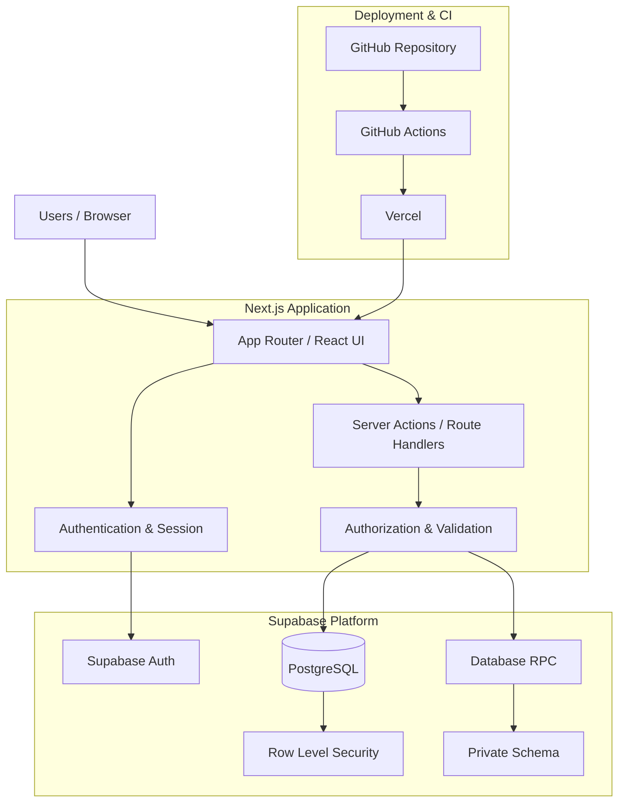
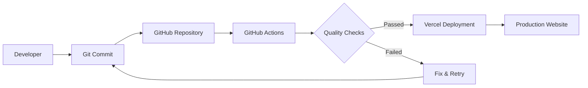

# 🏰 The Fellowship

<div align="center">

  

  **Cùng nhau đi xa hơn — biến mục tiêu chung thành hành động, quyết định và tri thức có thể kế thừa.**

  <p>
    <a href="https://the-fellowship-zeta.vercel.app/">🌐 Website</a> ·
    <a href="https://github.com/PhamDucDuy-2280605704/the-fellowship">GitHub Repository</a> ·
    <a href="./docs/00-PRODUCT-BRIEF.md">Product Brief</a> ·
    <a href="./docs/03-ARCHITECTURE.md">Architecture</a> ·
    <a href="./docs/04-ACCESS-CONTROL.md">Access Control</a>
  </p>

  
  
  
  
  
  

  
  
  [](https://github.com/PhamDucDuy-2280605704/the-fellowship/actions/workflows/verify.yml)

</div>

---

## 📖 1. Giới thiệu

**The Fellowship** là nền tảng cộng tác và quản lý tri thức dành cho các nhóm làm việc cùng hướng đến một mục tiêu chung.

Dự án giải quyết ba vấn đề phổ biến trong quá trình cộng tác:

- **Phân tán công việc:** Mục tiêu, nhiệm vụ, người phụ trách và tiến độ thường nằm ở nhiều nơi khác nhau.
- **Thiếu minh bạch trong quyết định:** Các cuộc thảo luận dễ bị lặp lại khi phương án, tiêu chí và lý do lựa chọn không được lưu trữ.
- **Mất mát tri thức:** Ghi chú, kinh nghiệm và thông tin quan trọng không được liên kết với công việc đã tạo ra chúng.

The Fellowship đưa các hoạt động này về một không gian làm việc thống nhất (**Workspace**), giúp thành viên theo dõi quá trình từ xác định mục tiêu, triển khai công việc, đưa ra quyết định đến lưu trữ tri thức.

> Define goals. Execute together. Decide transparently. Preserve knowledge.

### Đối tượng sử dụng

- Nhóm sinh viên thực hiện đồ án và dự án học tập.
- Nhóm phát triển sản phẩm và kỹ thuật.
- Câu lạc bộ, tổ chức và nhóm tình nguyện.
- Các đội nhóm cần quản lý công việc và lưu trữ tri thức tập trung.

---

## ✨ 2. Các tính năng chính

### ⚔️ 2.1. The Fellowship — Goals & Quests

**Goals — Mục tiêu**

- Tạo mục tiêu cho workspace, kèm tên, mô tả và thời hạn.
- Theo dõi trạng thái và vòng đời của mục tiêu.
- Lưu trữ mục tiêu khi không còn hoạt động.

**Quests — Nhiệm vụ**

- Tạo nhiệm vụ và liên kết với Goal.
- Thiết lập mức độ ưu tiên, hạn hoàn thành và trạng thái.
- Giao nhiệm vụ cho thành viên workspace.
- Theo dõi tiến độ bằng các lần check-in.

**Quest Dependencies — Quan hệ phụ thuộc**

- Thiết lập quan hệ phụ thuộc giữa các nhiệm vụ.
- Giới hạn quan hệ phụ thuộc trong cùng workspace.
- Ngăn chặn chu trình phụ thuộc không hợp lệ bằng kiểm tra ở tầng database.

### ⚖️ 2.2. The Council — Decisions & Governance

**Proposals — Đề xuất**

- Tạo đề xuất kèm bối cảnh và mô tả vấn đề.
- Xây dựng nhiều phương án lựa chọn.
- Mô tả ưu điểm, nhược điểm và rủi ro của từng phương án.
- Thiết lập tiêu chí đánh giá có trọng số và thời điểm kết thúc biểu quyết.

**Voting — Biểu quyết**

- Thành viên tham gia biểu quyết trong thời gian cho phép.
- Áp dụng nguyên tắc một thành viên — một phiếu.
- Bảo vệ dữ liệu phiếu thông qua cơ chế database/RPC.
- Tổng hợp kết quả mà không công khai danh tính lựa chọn trong dữ liệu tổng hợp.

**Weighted Scoring — Chấm điểm có trọng số**

- Đánh giá phương án theo từng tiêu chí.
- Áp dụng trọng số cho từng tiêu chí.
- Tổng hợp và chuẩn hóa kết quả trên thang điểm 0–100.

**Decisions — Quyết định**

- Owner/Admin quản lý quy trình quyết định theo quyền hạn.
- Ghi nhận phương án được lựa chọn và lý do.
- Lưu trữ đề xuất sau khi hoàn tất.
- Tạo Quest tiếp theo trực tiếp từ một quyết định.

### 📚 2.3. The Archives — Knowledge Management

**Notes — Ghi chú**

- Tạo và chỉnh sửa ghi chú.
- Soạn thảo và hiển thị nội dung Markdown an toàn.
- Lưu trữ và khôi phục ghi chú.

**Knowledge Organization — Tổ chức tri thức**

- Gắn thẻ và lọc ghi chú theo thẻ.
- Tìm kiếm toàn văn trên tiêu đề, nội dung và thẻ.
- Liên kết ghi chú với Goals, Quests và Council Proposals.
- Giới hạn dữ liệu trong phạm vi workspace tương ứng.

### 🤝 2.4. Workspace & Collaboration

- Đăng ký và đăng nhập bằng email/mật khẩu.
- Tạo workspace; người tạo tự động trở thành Owner.
- Mời thành viên bằng liên kết có token ngẫu nhiên được lưu dưới dạng SHA-256 hash.
- Lời mời hết hạn sau 7 ngày và có thể thu hồi.
- Quản lý danh sách thành viên và thay đổi vai trò.
- Gỡ thành viên hoặc tự rời workspace.
- Quản lý tên và mô tả workspace.

### 🕰️ 2.5. Activity Timeline

Hệ thống ghi nhận các hoạt động tạo/cập nhật Goal, Quest, Notes và Council Proposals. Timeline hiển thị tối đa 100 sự kiện gần nhất trong workspace.

### 🛡️ 2.6. Platform Administration

**Account Management**

- Xem danh sách tài khoản toàn nền tảng.
- Theo dõi trạng thái xác nhận email và lần đăng nhập gần nhất.
- Tạm khóa hoặc kích hoạt lại tài khoản.

**Workspace Management**

- Xem danh sách workspace toàn nền tảng.
- Kiểm tra thông tin workspace và thành viên.
- Lưu trữ hoặc khôi phục workspace.

Các thao tác quản trị nhạy cảm được kiểm tra tại PostgreSQL/RPC phía máy chủ, không phụ thuộc vào việc ẩn hoặc hiển thị giao diện.

---

## 🧭 3. Các khu vực trong ứng dụng

### Public Routes

| Route | Chức năng |
|---|---|
| `/` | Trang giới thiệu |
| `/signup` | Đăng ký tài khoản |
| `/login` | Đăng nhập |
| `/forgot-password` | Khôi phục mật khẩu |
| `/recovery-pin` | Thiết lập PIN khôi phục |

### Workspace Routes

| Route | Chức năng |
|---|---|
| `/workspaces` | Danh sách và tạo workspace |
| `/workspaces/[slug]` | Tổng quan workspace |
| `/workspaces/[slug]/goals` | Quản lý mục tiêu |
| `/workspaces/[slug]/quests` | Quản lý nhiệm vụ |
| `/workspaces/[slug]/council` | Thảo luận và quyết định |
| `/workspaces/[slug]/archives` | Quản lý tri thức |
| `/workspaces/[slug]/activity` | Lịch sử hoạt động |
| `/workspaces/[slug]/members` | Thành viên và lời mời |
| `/workspaces/[slug]/settings` | Cài đặt workspace |

### Platform Administration Routes

| Route | Chức năng |
|---|---|
| `/the-stewards-hall` | Dashboard quản trị |
| `/the-stewards-hall/login` | Đăng nhập quản trị |
| `/the-stewards-hall/accounts` | Quản lý tài khoản |
| `/the-stewards-hall/workspaces` | Quản lý workspace toàn nền tảng |

**Lưu ý:** Các URL quản trị công khai được rewrite nội bộ thông qua `src/proxy.ts`. Không sử dụng `/admin` hoặc `/steward-login` làm URL chia sẻ trực tiếp. Các khu vực workspace yêu cầu tài khoản đang hoạt động và membership hợp lệ.

---

## 🔐 4. Authentication & Access Control

The Fellowship sử dụng mô hình phân quyền hai cấp độc lập.

### 4.1. Platform Roles

| Vai trò | Phạm vi | Quyền hạn |
|---|---|---|
| Platform Admin | Toàn nền tảng | Quản lý tài khoản và workspace |
| User | Các workspace được tham gia | Sử dụng chức năng theo workspace role |

Platform Admin được quản lý thông qua bảng riêng trong schema `private`, không được cấp quyền dựa trên metadata do người dùng tự chỉnh sửa.

### 4.2. Workspace Roles

| Vai trò | Quyền hạn |
|---|---|
| Owner | Chủ sở hữu workspace, quản lý thành viên và thiết lập |
| Admin | Quản lý workspace và các hoạt động quản trị được cho phép |
| Member | Tham gia và đóng góp nội dung |
| Viewer | Chỉ xem dữ liệu |

**Nguyên tắc:** Workspace Admin không đồng nghĩa với Platform Admin.

### 4.3. Security Architecture

- PostgreSQL Row Level Security (RLS).
- Kiểm tra membership và vai trò tại database.
- Server-side authorization.
- Guarded RPC cho các thao tác đặc quyền.
- Phân tách schema `public` và `private`.
- Invitation token được lưu dưới dạng SHA-256 hash.
- Giới hạn thử đăng ký và khôi phục tài khoản.
- Kiểm soát trạng thái tài khoản đang hoạt động.
- PIN khôi phục tài khoản.
- Kiểm tra quyền trước khi xử lý các thao tác quan trọng.

### 4.4. Security Principles

1. Không tin tưởng dữ liệu phân quyền do client gửi lên.
2. Không cho phép người dùng truy cập workspace ngoài phạm vi membership.
3. Không cấp quyền Platform Admin qua `user_metadata`.
4. Không cung cấp Service Role Key cho trình duyệt.
5. Các thao tác quản trị phải được kiểm tra phía máy chủ/database.
6. RLS và database constraints là lớp bảo vệ dữ liệu quan trọng.

---

## 🏗️ 5. Technology Stack

| Thành phần | Công nghệ |
|---|---|
| Framework | Next.js 16.4.5 |
| Routing | Next.js App Router |
| UI Library | React 19.3.0 |
| Programming Language | TypeScript 5 |
| Styling | Tailwind CSS 4 |
| Additional Styling | CSS Modules |
| Authentication | Supabase Auth |
| Database | PostgreSQL |
| Database Security | Row Level Security |
| Backend | Supabase RPC |
| Supabase Integration | `@supabase/supabase-js` |
| Server-side Auth | `@supabase/ssr` |
| Code Quality | ESLint 9 |
| Testing | Node.js Test Runner |
| CI/CD | GitHub Actions |
| Hosting | Vercel |

### System Architecture



---

## 💻 6. Installation & Local Development

### 6.1. Requirements

- Node.js 22.
- npm.
- Git.
- Tài khoản Supabase.
- Supabase project có quyền cấu hình Auth, PostgreSQL và migrations.

### 6.2. Clone Repository

```bash
git clone https://github.com/PhamDucDuy-2280605704/the-fellowship.git

cd the-fellowship
```

### 6.3. Install Dependencies

```bash
npm ci
```

Sử dụng `npm ci` để cài đặt dependencies theo lockfile.

### 6.4. Configure Environment Variables

Tạo file `.env.local` từ file mẫu `.env.example`.

**Windows PowerShell:**

```powershell
Copy-Item .env.example .env.local
```

**macOS / Linux:**

```bash
cp .env.example .env.local
```

Cấu hình các biến môi trường:

```env
NEXT_PUBLIC_SUPABASE_URL=https://<project-ref>.supabase.co
NEXT_PUBLIC_SUPABASE_PUBLISHABLE_KEY=<your-publishable-key>
NEXT_PUBLIC_SITE_URL=http://localhost:3000
```

| Variable | Description |
|---|---|
| `NEXT_PUBLIC_SUPABASE_URL` | URL của Supabase project |
| `NEXT_PUBLIC_SUPABASE_PUBLISHABLE_KEY` | Publishable key của Supabase |
| `NEXT_PUBLIC_SITE_URL` | URL gốc của ứng dụng |

**Lưu ý bảo mật:**

- Không commit `.env.local` lên GitHub.
- Không đưa Service Role Key vào biến `NEXT_PUBLIC_*`.
- Không chia sẻ database password hoặc secret keys.
- Chỉ sử dụng Publishable Key trong môi trường trình duyệt.

### 6.5. Configure Supabase Authentication

Trong Supabase Dashboard:

1. Mở Authentication.
2. Truy cập URL Configuration.
3. Cấu hình Site URL.
4. Thêm callback URL vào Redirect URLs.

Local callback:

```text
http://localhost:3000/auth/callback
```

Production callback cần sử dụng domain production thực tế.

### 6.6. Run Development Server

```bash
npm run dev
```

Mở trình duyệt tại http://localhost:3000.

---

## 🗄️ 7. Database & Supabase

The Fellowship sử dụng Supabase làm nền tảng backend, bao gồm Authentication, PostgreSQL, RLS và RPC.

### 7.1. Database Modules

| Module | Thành phần |
|---|---|
| Identity | Profiles, account controls |
| Workspace | Workspaces, members, invitations |
| Activity | Activity events |
| Goals & Quests | Goals, quests, assignments, dependencies, check-ins |
| Council | Proposals, options, votes, criteria, scores, decisions |
| Archives | Notes |
| Platform Administration | Platform admins, user status |

### 7.2. Database Security

- RLS được bật trên các bảng ứng dụng thuộc schema `public`.
- Người dùng thông thường chỉ được truy cập dữ liệu thuộc workspace có membership hợp lệ.
- Membership changes được thực hiện thông qua RPC có kiểm tra quyền.
- Các thao tác đặc quyền được bảo vệ bằng server-side identity checks.
- Các bảng quản trị nhạy cảm nằm trong schema `private`.

### 7.3. Migration Management

Các migration được lưu tại:

```text
supabase/
└── migrations/
```

Tạo migration mới:

```bash
supabase migration new <migration_name>
```

Quy trình migration:

1. Kiểm tra nội dung SQL.
2. Rà soát RLS policies.
3. Kiểm tra quyền thực thi RPC.
4. Áp dụng migration vào đúng Supabase project.
5. Cập nhật database types nếu schema/RPC thay đổi.
6. Kiểm tra migration history.
7. Commit migration vào Git.

Không chỉnh sửa trực tiếp migration đã được áp dụng trên production.

Xem thêm: [Supabase README](./supabase/README.md).

---

## 🧪 8. Testing & Code Quality

The Fellowship sử dụng nhiều lớp kiểm tra để đảm bảo chất lượng mã nguồn.

### Available Scripts

| Command | Description |
|---|---|
| `npm run dev` | Chạy development server |
| `npm run build` | Build production |
| `npm run start` | Chạy production server |
| `npm run lint` | Kiểm tra ESLint |
| `npm run typecheck` | Kiểm tra TypeScript |
| `npm test` | Chạy unit tests |
| `npm run test:smoke` | Kiểm tra route bằng production build |

### Recommended Verification

Trước khi push code:

```bash
npm run lint
npm run typecheck
npm test
npm run build
npm run test:smoke
```

### CI/CD Pipeline

GitHub Actions được cấu hình trong:

```text
.github/workflows/verify.yml
```

Pipeline thực hiện các bước xác minh:

- Cài đặt dependencies từ lockfile.
- Audit dependencies production.
- ESLint.
- TypeScript type checking.
- Unit tests.
- Production build.
- Route smoke tests.

Workflow được kích hoạt theo cấu hình GitHub Actions khi có thay đổi trên nhánh `main`, Pull Request hoặc chạy thủ công.

**Lưu ý:** Build thành công không đồng nghĩa với việc toàn bộ phân quyền, RLS và luồng xác thực production đã được xác minh.

---

## 🚀 9. Deployment

The Fellowship được triển khai thông qua Vercel và liên kết với GitHub Repository.

### Production Website

🌐 https://the-fellowship-zeta.vercel.app/

### Deployment Workflow



### Deployment Requirements

- Các biến môi trường Supabase đã được cấu hình.
- Production URL được khai báo trong Supabase Auth.
- Database migrations đã được áp dụng.
- Các kiểm tra CI hoàn thành thành công.
- RLS và quyền truy cập đã được kiểm tra.
- Authentication hoạt động đúng trên môi trường thực tế.

---

## 📂 10. Project Documentation

Tài liệu kỹ thuật và nghiệp vụ được quản lý trong thư mục `docs/`.

| Document | Description |
|---|---|
| [Product Brief](./docs/00-PRODUCT-BRIEF.md) | Tầm nhìn và mục tiêu sản phẩm |
| [MVP Scope](./docs/01-MVP-SCOPE.md) | Phạm vi MVP |
| [Domain Model](./docs/02-DOMAIN-MODEL.md) | Mô hình dữ liệu và nghiệp vụ |
| [Architecture](./docs/03-ARCHITECTURE.md) | Kiến trúc hệ thống |
| [Access Control](./docs/04-ACCESS-CONTROL.md) | Vai trò, quyền hạn và RLS |
| [Roadmap](./docs/05-ROADMAP.md) | Tiến độ và các giai đoạn phát triển |
| [Architecture Decisions](./docs/06-DECISIONS.md) | Các quyết định kiến trúc |
| [Supabase Foundation](./docs/07-SUPABASE-FOUNDATION.md) | Nền tảng Supabase |
| [Auth Onboarding](./docs/08-AUTH-ONBOARDING.md) | Hướng dẫn kiểm tra authentication |
| [Supabase README](./supabase/README.md) | Database, migrations và vận hành |

---

## 🛣️ 11. Development Roadmap

Dự án được phát triển theo từng giai đoạn.

| Giai đoạn | Nội dung | Trạng thái |
|---|---|---|
| Stage 1 | Repository & Application Foundation | Completed |
| Stage 2 | Supabase & Authentication | Implemented |
| Stage 3 | Platform Administration | Integrated |
| Stage 4 | Workspace & Membership | Implemented |
| Stage 5 | Goals & Quests | Implemented |
| Stage 6 | Activity & Archives | Implemented |
| Stage 7 | The Council | Integrated |
| Stage 8 | Advanced Archives | Integrated |

### Remaining Release Gates

Trước khi xác nhận MVP đã được production-verified, cần hoàn thành:

- Kiểm tra đăng ký, xác nhận email và đăng nhập.
- Kiểm tra PIN khôi phục và password recovery.
- Kiểm tra cách ly dữ liệu giữa các workspace.
- Kiểm tra ma trận quyền Owner, Admin, Member và Viewer.
- Kiểm tra lời mời, hết hạn và thu hồi lời mời.
- Kiểm tra Platform Admin và tài khoản thông thường.
- Kiểm tra RPC và RLS trên môi trường thực tế.
- Xác minh deployment production tương ứng với commit hiện tại.

Trạng thái chi tiết được cập nhật trong [Roadmap](./docs/05-ROADMAP.md).

---

## ⚠️ 12. Important Security Notes

1. Không commit `.env.local` hoặc secret keys.
2. Không sử dụng Service Role Key ở client-side.
3. Không bỏ qua RLS khi bổ sung bảng dữ liệu mới.
4. Không cấp quyền Platform Admin bằng user metadata.
5. Không cho phép client tự quyết định quyền truy cập.
6. RPC có đặc quyền phải kiểm tra danh tính và vai trò.
7. Migration phải được kiểm tra trước khi áp dụng production.
8. Các thay đổi liên quan đến authentication phải được kiểm thử bằng nhiều tài khoản riêng biệt.

**Operational note:** Cấu hình Leaked Password Protection trong Supabase Auth hiện cần được bật theo khuyến nghị vận hành của dự án. Cần hoàn tất việc này trước khi xem hệ thống là đã sẵn sàng production.

---

## 🤝 13. Contribution

Mọi thay đổi trong dự án nên tuân thủ các nguyên tắc:

- Giữ kiến trúc và phân chia module rõ ràng.
- Không phá vỡ các quy tắc phân quyền hiện có.
- Kiểm tra RLS và database constraints khi thay đổi schema.
- Cập nhật tài liệu khi thay đổi chức năng.
- Chạy các bước kiểm tra trước khi tạo Pull Request.

### Development Workflow

```bash
npm run lint
npm run typecheck
npm test
npm run build
npm run test:smoke
```

---

## 📌 14. Project Information

| Information | Details |
|---|---|
| Project | The Fellowship |
| Version | 0.3.0 |
| Repository | PhamDucDuy-2280605704/the-fellowship |
| Framework | Next.js 16 |
| Frontend | React 19 + TypeScript |
| Backend | Supabase |
| Database | PostgreSQL |
| Deployment | Vercel |
| Main Branch | `main` |

### Useful Links

- 🌐 **Live Website:** https://the-fellowship-zeta.vercel.app/
- 💻 **GitHub Repository:** https://github.com/PhamDucDuy-2280605704/the-fellowship
- ⚙️ **GitHub Actions:** https://github.com/PhamDucDuy-2280605704/the-fellowship/actions
- 📖 **Product Brief:** [docs/00-PRODUCT-BRIEF.md](./docs/00-PRODUCT-BRIEF.md)
- 🏗️ **Architecture:** [docs/03-ARCHITECTURE.md](./docs/03-ARCHITECTURE.md)

---

<div align="center">

  **🏰 THE FELLOWSHIP**

  *Goals. Decisions. Knowledge.*

  *Cùng nhau đi xa hơn, cùng nhau lưu giữ những điều có giá trị.*

  <sub>Built with Next.js, React, TypeScript and Supabase.</sub>

</div>
