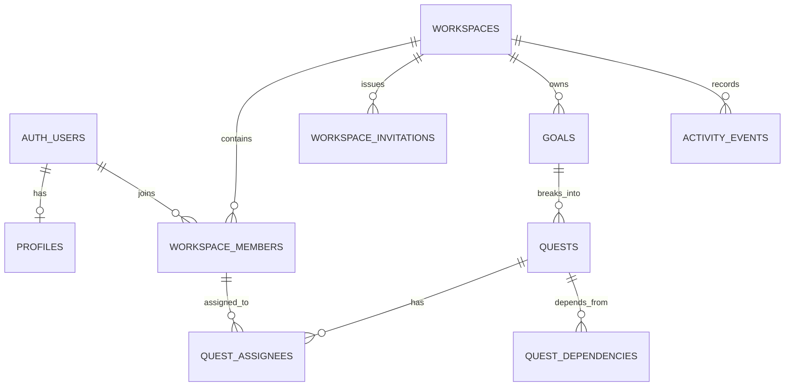

# Domain model — first proposal

> Logical design only. Review constraints and access patterns before generating SQL.

## Core entities

| Entity | Responsibility | Release |
|---|---|---|
| profiles | Display name and avatar reference for an Auth user | 1 |
| workspaces | Team/project boundary and settings | 1 |
| workspace_members | Membership and workspace-scoped role | 1 |
| workspace_invitations | Pending, accepted, expired, or revoked invitations | 1 |
| goals | Shared outcome or milestone direction | 1 |
| quests | Work item within a goal | 1 |
| quest_assignees | Many-to-many quest/member assignment | 1 |
| quest_dependencies | Directed dependency between quests | 1 |
| check_ins | Progress update or completion note | 1 |
| activity_events | Append-only record of meaningful activity | 1 |
| notes | Markdown knowledge item | 1 |
| tags, collections, note_links | Knowledge organization and backlinks | 3 |
| proposals, options, criteria, votes, decisions | Council workflow | 2 |

## Relationships

## Important fields and constraints

- Workspace: UUID, name, optional description, unique slug, creator, timestamps, optional archive timestamp.
- Membership: workspace_id, user_id, role, status, joined_at; unique workspace/user pair. Roles: owner, admin, member, viewer. Exactly one active owner initially; transfer is explicit.
- Goal: workspace_id, title, description, status, start/target dates, creator, timestamps. Statuses: draft, active, on_hold, completed, archived.
- Quest: workspace_id, goal_id, title, description, status, priority, start/due dates, creator, timestamps. Statuses: backlog, ready, in_progress, blocked, done, cancelled. Priorities: low, medium, high, urgent.
- Assignment: workspace_id, quest_id, user_id, assigned_by, assigned_at. Assignee must be an active member of the same workspace.
- Dependency: workspace_id, quest_id, depends_on_quest_id, created_by, created_at. Reject self-dependency, cross-workspace links, duplicates, and cycles.
- Activity: workspace_id, actor_user_id, event_type, entity_type, entity_id, minimal payload, created_at. Ordinary clients cannot update/delete events.

## Integrity rules

1. Workspace-owned rows carry or join through an explicit workspace boundary.
2. Cross-workspace references are rejected at the database boundary.
3. Membership role is stored in workspace_members; user-editable metadata is never an authorization source.
4. Leaving a workspace has a defined reassignment policy for open work.
5. Dependency graphs are acyclic.
6. Activity is append-only for normal client roles.
7. Prefer archive/soft-delete for goals and quests to preserve history.

## Questions to settle before SQL

- Multi-workspace membership: yes.
- Multiple owners in v1: no; one owner with explicit transfer.
- Multiple quest assignees: yes.
- Nested goals: no in v1.
- Quests shared between goals: no in v1.
- Dependencies across goals within one workspace: yes.
