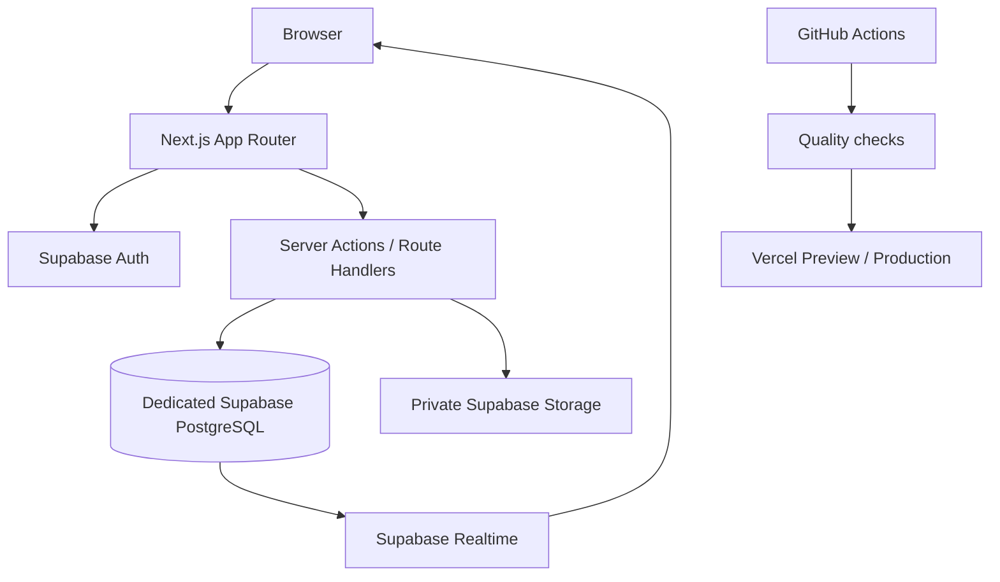

# Architecture proposal

## High-level shape

## Boundaries

- Separate repository, Supabase project, storage buckets, environment variables, and deployment.
- `little-story-world` is a pattern reference only.
- Browser receives only the Supabase publishable key.
- Secret/service-role credentials remain server-only and are never prefixed with `NEXT_PUBLIC_`.
- Use the current recommended Supabase SSR integration when auth is implemented; verify official docs then.

## Application layers

- `app/`: routes, layouts, loading/error boundaries, metadata.
- `features/auth/`: login and session-aware experience.
- `features/workspaces/`: workspace, settings, membership, invitations.
- `features/goals/`: goal lifecycle.
- `features/quests/`: quest CRUD, assignment, dependencies, check-ins.
- `features/activity/`: timeline read model and event presentation.
- `features/archives/`: basic notes first; tags/backlinks later.
- `features/council/`: reserved for later proposal/voting workflows.
- `lib/supabase/`: browser/server clients and session helpers.
- `lib/validation/`, `lib/authz/`: input validation and permission checks.
- `types/`: generated database and domain types.
- `supabase/migrations/`: dedicated migration history.

## Data access

- Reads and writes are scoped by authenticated identity and workspace membership.
- Server actions validate input and permission; RLS and database constraints remain authoritative.
- Realtime subscriptions are workspace-scoped with reconnect/refetch handling.
- Avoid broad SECURITY DEFINER functions. If unavoidable, isolate in a non-exposed schema, fix search_path, verify auth.uid() and grants, and run advisors.

## Realtime and storage

Start with invalidation/refetch for scoped updates rather than fully synchronized client state. Private attachments use a private bucket, workspace/object-scoped paths, role-aware policies, file validation, and short-lived signed URLs.

## Quality gates

CI must run dependency install from lockfile, lint, typecheck, unit tests, integration/authorization tests as implemented, production build, and route smoke tests. A green build does not prove workspace isolation; cross-tenant denial tests are release blockers.
